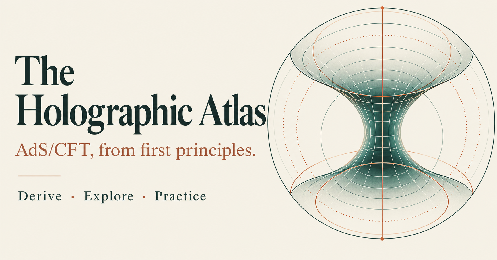

# The Holographic Atlas

An interactive AdS/CFT learning project by Olivia Rieva, built around the NBI Gauge/Gravity Duality course and personal study notes.

[Open the website](https://holographic-atlas.oliviarieva.chatgpt.site) · [Read the CFT/AdS notes](https://holographic-atlas.oliviarieva.chatgpt.site/notes) · [Explore the correspondence and D3-brane lab](https://holographic-atlas.oliviarieva.chatgpt.site/correspondence) · [Practice questions](https://holographic-atlas.oliviarieva.chatgpt.site/quiz)

The central question is not just *what is the formula?*, but *why do we introduce it, what assumptions make it valid, and how does it connect the two theories?* Field theory and geometry have independent reading paths, with explicit connections and a separate matching dictionary.

**My role:** learning goals, personal notes, research questions, interaction design, and iterative feedback. Implementation and explanatory content were developed with Codex. This is a learning and scientific-communication project, not a claim to have derived or independently verified all of AdS/CFT. Course authors and sources are credited below.

<p align="center">
  <a href="https://holographic-atlas.oliviarieva.chatgpt.site">
    
  </a>
</p>

## Content

- 98 page-by-page lessons, preserving the original PDF and page images.
- 448 equation entries with explanations, derivations, conventions and corrections.
- Mathematical and physical foundations, interactive geometry labs, and a 304-question practice bank.
- All 17 tabs of the supplied Google Doc, including 3,891 image/drawing objects and 330 native equations; source order is retained.
- Reader’s guides synthesize notebook questions. OCR supports search, not authoritative mathematical transcription. Original images remain available at full resolution.
- `/notes`: 106 rewritten reading sections and 477 native equation blocks from the green-selected notes and chapter 7. Includes the additional SUSY highlights fetched on 13 October 2026. CFT and AdS flow independently; explicit cross-links connect related passages without matching their row positions.
- `/correspondence`: a matching dictionary, a five-step chapter-4 source/response explanation, and a D3-brane lab with movable bundles and observers, probe strings, redshift, decoupling and thermal geometry.
- `/notes/source`: the preserved earlier image-based archive. It is not a live synchronization of the Google Doc.

## Suggested learning path

1. Start with the [CFT and AdS reading room](https://holographic-atlas.oliviarieva.chatgpt.site/notes). Follow either column independently, then use its cross-links to connect field-theory concepts with geometry.
2. Open the [correspondence dictionary and D3-brane lab](https://holographic-atlas.oliviarieva.chatgpt.site/correspondence). Compare the full extremal geometry with the decoupled throat before exploring the thermal model; these are distinct physical settings.
3. Use the [practice questions](https://holographic-atlas.oliviarieva.chatgpt.site/quiz) to identify topics to revisit. Save your ATLAS recovery code if you want to recover learning progress on another browser or device.
4. When an equation or explanation is unclear, compare it with the preserved source images and the stated conventions. Rendered notation and passing software tests do not independently establish physical correctness.

For a source-file inventory, see the [content index](docs/CONTENT_INDEX.md). To suggest a correction, include the page, equation or passage, the proposed change, and a supporting source so the discrepancy can be checked.

## Editing the new reading pages

Text and LaTeX are in `app/content/reading-cft.ts`, `reading-ads.ts`, and `reading-susy-strings.ts`. `reading.ts` combines them and defines explicit cross-column connections. `app/notes/ReadingRoom.tsx` renders the independent columns; `app/reading.css` controls their appearance. The correspondence components are in `app/correspondence/`; numerical D3 formulas are in `lib/d3.ts`.

The source review is mapped by selected paragraph ranges and visually inspected image IDs. Duplicate screenshots and repeated explanations are consolidated. This is not an occurrence-by-occurrence equation ledger, nor a new certification of every page of the original course. An incomplete 10D SUSY transformation in the notes is presented structurally with proportionality signs rather than guessed normalization coefficients. KaTeX tests validate notation syntax, not physical correctness.

The D3 lab uses the course convention `gYM² = 2πgs`, `L⁴ = 2λα′²`. Its string counts are probe illustrations and do not backreact. Its SUSY checkbox reveals multiplet information rather than changing the background theory. The full extremal geometry, decoupled throat, and coincident thermal black brane are distinct models. The spatial throat drawing has a compressed vertical scale; the frequency map compares supported static observers and does not trace null geodesics.

The source is *Lecture notes for GGD 2021*, Stefano Baiguera, Niels Obers and Gerben Oling (3 June 2021). Notes were imported from the document supplied by the site owner. Corrections are marked separately from originals. This is an explanatory companion, not a claim of infallibility or coverage of all research beyond this course.

## Development

Node.js >=22.13.0. Install with `npm install`; run `npm run dev`, `npm run build`, and `npm test`. Retain the vinext / Cloudflare Workers structure and Sites build plugin.

```sh
git clone https://github.com/OliviaRieva/ads-cft-atlas.git
cd ads-cft-atlas
npm ci
npm run dev
```

The last published content update passed 60 automated tests covering equation rendering, source mappings, numerical physics, production page rendering, and quiz persistence. Browser visual review and a separate equation-occurrence completeness audit remain distinct tasks; passing the tests does not certify every physical statement.

The repository includes course/reference assets, so its initial download is larger than a code-only application. Ignored local exports, credentials, dependency directories, build output, runtime databases and learner progress are not uploaded.

### Working on the original checkout

The original checkout keeps `origin` for the existing Sites host and adds a separate `github` remote for this public repository. To upload new committed source to GitHub, use `git push github main`. This does **not** deploy the website; website publication remains a separate Sites workflow. A normal clone from this GitHub repository will instead call GitHub `origin`, so use `git push origin main` there.

## Repository maintenance

[](https://github.com/OliviaRieva/ads-cft-atlas/actions/workflows/daily-maintenance.yml)

GitHub runs the build, TypeScript checks and tests daily at 09:17 Copenhagen time. Successful scheduled/manual runs refresh the [content index](docs/CONTENT_INDEX.md) only when its source data change. Dependabot proposes dependency updates for review; nothing is automatically merged or deployed. Automated changes use bot attribution, and unchanged content produces no commit.

See [maintenance controls](docs/MAINTENANCE.md) for the full scope, test limitations and how to pause or stop both schedules.

## Learning progress

D1 stores individual learner profiles, test snapshots and answers. A random HttpOnly cookie identifies a profile. Only hashes of authentication/recovery secrets are stored. Save an ATLAS recovery code to restore a profile on another browser/device. Do not share that code. Clearing cookies without a recovery code loses access to the profile; progress is not merely localStorage data. Browser storage is used only for the reading-place preference.

Tests contain unique questions. Three consecutive correct answers across tests establish mastery; a wrong answer resets the streak. Accuracy counts recorded attempts separately from mastered-question counts. End-of-test mode withholds correctness and explanation until completion. Answer keys remain server-side until the configured reveal point.

## Source ingestion

`scripts/extract_pdf.swift` renders the supplied PDF with PDFKit. `scripts/ingest-notes.mjs` downloads document images; `scripts/ocr-notes.swift` extracts search text with Vision; `scripts/prepare-notes.py` preserves structured blocks and converts native OMML equations recovered from tab DOCX exports. Private download URLs and intermediate exports stay in ignored `tmp/`, never in public data.

## Hosting

`.openai/hosting.json` declares the logical D1 binding and records the Sites project ID after creation. Sites supplies the deployed database and applies the checked-in Drizzle migration. Local migration configuration is in `db/wrangler.local.jsonc`; it is not the production database.

The bespoke social card in `public/og.png` was generated with the built-in image tool from this brief: warm ivory/teal/terracotta editorial card, title “The Holographic Atlas”, subtitle “AdS/CFT, from first principles.”, and “Derive · Explore · Practice”, with decorative boundary/bulk geometry. It is decorative, not a physical diagram.
